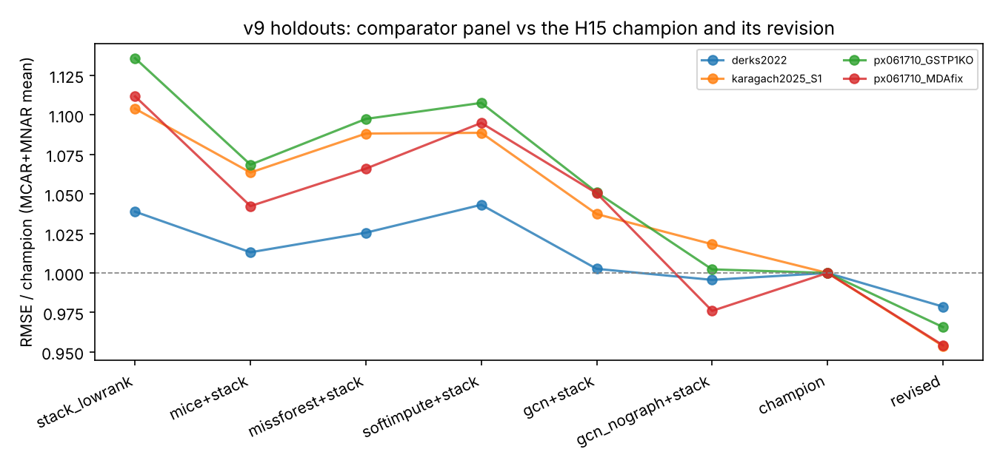

# v9 holdout results (generated by `scripts/summarize_v9.py` from `results/confirm_v9/*.json`)

Preregistration: `benchmarks/PREREGISTRATION_v9.md`. ✗ = the test failed (95% CI not entirely below 0, or the change is smaller than the 1% SESOI). Negative = lower RMSE than the comparator.

## Verdicts (primary holdouts)

| Hypothesis | derks2022 | karagach2025 | px061710 | Overall |
|---|---|---|---|---|
| H16 champion beats all 5 comparators | ✗ | ✓ | pending | pending (1 confirmed, 1 not, 1 outstanding) |
| H17 revision beats champion | ✓ | ✓ | pending | **CONFIRMED** (2 of 3 primary projects) |
| H18 revision beats strongest typical methods | ✗ | ✓ | pending | pending (1 confirmed, 1 not, 1 outstanding) |

## Per holdout (tests passed)

| Holdout | Role | Cells × proteins | Missing | H16 | H17 | H18 |
|---|---|---|---|---|---|---|
| derks2022 | primary | 125 × 1093 | 0.57 | 12/20 | 4/4 | 11/12 |
| karagach2025_S1 | primary | 258 × 3687 | 0.33 | 20/20 | 4/4 | 12/12 |
| px061710_GSTP1KO | primary | 78 × 3899 | 0.43 | 18/20 | 4/4 | 12/12 |
| px061710_MDAfix | primary | 76 × 3325 | 0.38 | 16/20 | 4/4 | 11/12 |
| px061710_RKOfix | primary | | | not run yet | | |
| khan2023 | secondary | | | not run yet | | |
| brunner2022 | secondary | | | not run yet | | |
| karagach2025_S2 | secondary | | | not run yet | | |
| px077946_H2O2 | secondary | | | not run yet | | |

## Strict-SESOI reading (post hoc; see docs/v9_review.md)

The preregistration applies the 1% SESOI to the point estimate (as the code and v8 do). Under the stricter reading - the 95% CI upper bound itself must be <= -1% - the counts are:

| Holdout | H16 strict | H17 strict | H18 strict |
|---|---|---|---|
| derks2022 | 12/20 | 2/4 | 8/12 |
| karagach2025_S1 | 19/20 | 4/4 | 12/12 |
| px061710_GSTP1KO | 18/20 | 4/4 | 11/12 |
| px061710_MDAfix | 16/20 | 4/4 | 10/12 |

## Champion vs comparators, MCAR, all entries (in-complex in brackets)

| Holdout | stack_lowrank | champion@null | champion@noref | gcn_nograph+stack | gcn+stack | revised vs champion |
|---|---|---|---|---|---|---|
| derks2022 | -3.0% (-3.1%) | -2.7% (-2.7%) | -2.6% (-2.6%) | +0.3% ✗ (-0.1% ✗) | -0.0% ✗ (-0.2% ✗) | -1.2% (-1.1%) |
| karagach2025_S1 | -7.7% (-9.0%) | -4.0% (-4.9%) | -4.8% (-6.0%) | -1.2% (-1.8%) | -3.1% (-3.2%) | -3.2% (-3.4%) |
| px061710_GSTP1KO | -9.9% (-11.2%) | -3.6% (-4.0%) | -4.6% (-5.4%) | +1.1% ✗ (+0.2% ✗) | -4.5% (-4.8%) | -2.1% (-2.2%) |
| px061710_MDAfix | -7.3% (-8.1%) | -3.3% (-3.4%) | -2.8% (-3.0%) | +2.6% ✗ (+2.2% ✗) | -4.1% (-4.8%) | -3.1% (-3.2%) |

## Champion vs comparators, MNAR, all entries (in-complex in brackets)

| Holdout | stack_lowrank | champion@null | champion@noref | gcn_nograph+stack | gcn+stack | revised vs champion |
|---|---|---|---|---|---|---|
| derks2022 | -4.4% (-4.2%) | -4.1% (-3.7%) | -4.3% (-4.0%) | +0.6% ✗ (+0.6% ✗) | -0.5% ✗ (-0.4% ✗) | -3.0% (-2.8%) |
| karagach2025_S1 | -11.1% (-12.4%) | -4.1% (-5.1%) | -7.2% (-8.2%) | -2.4% (-3.2%) | -4.1% (-4.1%) | -6.0% (-7.0%) |
| px061710_GSTP1KO | -14.0% (-15.6%) | -4.1% (-4.6%) | -8.3% (-9.1%) | -1.5% (-3.1%) | -5.2% (-4.9%) | -4.7% (-5.4%) |
| px061710_MDAfix | -12.7% (-14.7%) | -3.8% (-4.4%) | -6.9% (-8.1%) | +2.3% ✗ (+0.6% ✗) | -5.4% (-6.7%) | -6.1% (-5.0%) |

## Full panel: RMSE relative to the champion (mean of MCAR and MNAR, all entries)

| Method | derks2022 | karagach2025_S1 | px061710_GSTP1KO | px061710_MDAfix | mean |
|---|---|---|---|---|---|
| revised | 0.979 | 0.954 | 0.966 | 0.954 | 0.963 |
| gcn_nograph+stack | 0.996 | 1.018 | 1.002 | 0.976 | 0.998 |
| gcn_nograph | 0.994 | 1.020 | 1.002 | 0.976 | 0.998 |
| champion | 1.000 | 1.000 | 1.000 | 1.000 | 1.000 |
| gcn+stack | 1.003 | 1.037 | 1.051 | 1.050 | 1.035 |
| champion@null | 1.035 | 1.042 | 1.040 | 1.037 | 1.039 |
| imc_embed+stack | 1.007 | 1.059 | 1.066 | 1.052 | 1.046 |
| rwr_resid+stack | 1.017 | 1.052 | 1.070 | 1.048 | 1.047 |
| mice+stack | 1.013 | 1.064 | 1.069 | 1.042 | 1.047 |
| champion@noref | 1.036 | 1.064 | 1.069 | 1.051 | 1.055 |
| itersvd+stack | 1.015 | 1.077 | 1.080 | 1.070 | 1.061 |
| imc_embed | 1.012 | 1.091 | 1.080 | 1.066 | 1.062 |
| dae+stack | 1.020 | 1.088 | 1.098 | 1.061 | 1.067 |
| missforest+stack | 1.025 | 1.088 | 1.097 | 1.066 | 1.069 |
| grmf_string+stack | 1.029 | 1.081 | 1.096 | 1.079 | 1.071 |
| gcn | 1.050 | 1.075 | 1.076 | 1.106 | 1.077 |
| gcn_null+stack | 1.036 | 1.074 | 1.102 | 1.099 | 1.078 |
| rwr_resid | 1.047 | 1.084 | 1.107 | 1.076 | 1.079 |
| bpca+stack | 1.039 | 1.094 | 1.096 | 1.094 | 1.081 |
| softimpute+stack | 1.043 | 1.089 | 1.108 | 1.095 | 1.084 |
| mice | 1.054 | 1.112 | 1.103 | 1.073 | 1.086 |
| grmf_datagraph+stack | 1.038 | 1.098 | 1.121 | 1.105 | 1.090 |
| stack_lowrank | 1.039 | 1.104 | 1.136 | 1.112 | 1.098 |
| mean+stack | 1.039 | 1.104 | 1.136 | 1.112 | 1.098 |
| mindet+stack | 1.039 | 1.104 | 1.136 | 1.112 | 1.098 |
| minprob+stack | 1.039 | 1.104 | 1.136 | 1.112 | 1.098 |
| knn+stack | 1.039 | 1.104 | 1.136 | 1.112 | 1.098 |
| softimpute | 1.074 | 1.122 | 1.141 | 1.130 | 1.117 |
| missforest | 1.070 | 1.144 | 1.152 | 1.104 | 1.118 |
| itersvd | 1.084 | 1.199 | 1.138 | 1.157 | 1.144 |
| knn | 1.080 | 1.166 | 1.210 | 1.174 | 1.158 |
| grmf_string | 1.107 | 1.182 | 1.184 | 1.170 | 1.161 |
| bpca | 1.190 | 1.162 | 1.147 | 1.179 | 1.169 |
| gcn_null | 1.124 | 1.131 | 1.188 | 1.240 | 1.171 |
| grmf_datagraph | 1.158 | 1.257 | 1.321 | 1.321 | 1.264 |
| lowrank | 1.238 | 1.329 | 1.335 | 1.318 | 1.305 |
| mean | 1.190 | 1.260 | 1.369 | 1.417 | 1.309 |
| dae | 1.321 | 1.524 | 1.563 | 1.509 | 1.479 |
| mindet | 3.352 | 6.448 | 10.399 | 8.262 | 7.115 |
| minprob | 3.474 | 6.505 | 10.456 | 8.324 | 7.190 |

## Does STRING help the GCN? (`gcn` vs its graph controls; ✗ = not better by ≥1% with CI < 0)

| Holdout | mask | vs shuffled STRING | vs no graph |
|---|---|---|---|
| derks2022 | MCAR | -7.1% | +6.1% ✗ |
| derks2022 | MNAR | -6.0% | +5.1% ✗ |
| karagach2025_S1 | MCAR | -5.2% | +7.2% ✗ |
| karagach2025_S1 | MNAR | -4.7% | +3.5% ✗ |
| px061710_GSTP1KO | MCAR | -9.9% | +9.4% ✗ |
| px061710_GSTP1KO | MNAR | -8.9% | +5.5% ✗ |
| px061710_MDAfix | MCAR | -10.4% | +14.9% ✗ |
| px061710_MDAfix | MNAR | -11.3% | +11.8% ✗ |

